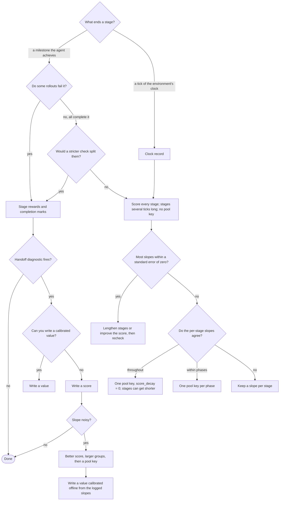

# Algorithms

This page covers the math and the configurable algorithmic components: the algorithm abstraction and its algorithms, how async training and staleness work, the loss components and advantage functions, curricula, and how multi-turn rollouts get merged into training samples.

## Table of Contents

- [The Algorithm Abstraction](#the-algorithm-abstraction)
  - [Model References](#model-references)
  - [The Algorithms](#the-algorithms)
  - [Customizing Components](#customizing-components)
  - [Per-Env Algorithms](#per-env-algorithms)
  - [The Algorithm Classes](#the-algorithm-classes)
- [Async Training & Staleness](#async-training--staleness)
- [Loss](#loss)
  - [Loss Components](#loss-components)
  - [IPO Loss](#ipo-loss)
  - [Custom Loss](#custom-loss)
- [Advantage](#advantage)
  - [Default Advantage](#default-advantage)
  - [Hierarchical GRPO](#hierarchical-grpo)
  - [Self-Play Advantage (RAE)](#self-play-advantage-rae)
  - [Authoring an Algorithm](#authoring-an-algorithm)
  - [Reference Scoring](#reference-scoring)
- [Curricula](#curricula)
- [Multi-Turn Trajectories](#multi-turn-trajectories)
  - [Extension Property](#extension-property)
  - [Best-Effort Interleaving](#best-effort-interleaving)
  - [Renderers](#renderers)
  - [Discontinuous Trajectories](#discontinuous-trajectories)

## The Algorithm Abstraction

A training algorithm in `prime-rl` is configured under `[orchestrator.train.algo]`, where **`type` names the algorithm** (`grpo`, `opd`, `sft`, …) and the class defaults are its vetted setting. It has two parts:

1. **Sampling** (`algo.sampling`) — how train rollouts are produced: which model generates them. `source` is a [model reference](#model-references): `"policy"` (the live policy, the default) or an inline frozen hosted model. Group sizing stays on the env config (`group_size`).
2. **The per-token training signal** — credit assignment and loss routing, fused; the algorithm's own parameters sit directly on `algo`. One mapping from a finalized rollout to per-token *(loss component, weight)* pairs — the credit a token gets and the loss that consumes it are two coordinates of the same output. Group-relative algorithms compute credit on the orchestrator and ship per-token advantage streams; reference-KL algorithms query a reference model at batch-ship time (bounded concurrency) and ship its prefill logprobs for the trainer to evaluate against the live policy. The `type` determines which loss component consumes the action tokens (`rl` / `ce` / `ref_kl`) and what happens to env-provided observation tokens in multi-turn rollouts (masked out by default; `echo` trains on them with weighted CE).

The trainer is algorithm-blind: the loss is a sum of three components (rl, ce, ref_kl), each normalized by its own global token count; per-token streams ship on the wire (the `rl_weights` / `ce_weights` / `ref_kl_weights` component weights plus the `advantages` stream on each training sample) and the trainer just executes them. Adding an algorithm never touches the dispatcher, batch packing, or trainer hot path.

### Model References

`prime-rl` hosts exactly one model: the trainable policy (`[orchestrator.model]`). Every other model an algorithm uses is an external OpenAI-compatible endpoint, declared *inline on the component that uses it*. A model reference is either the string `"policy"` (the live policy) or a frozen hosted model (`name` + `base_url`):

```toml
[orchestrator.train.algo]
type = "opd"

[orchestrator.train.algo.teacher]   # opd's teacher: the frozen model it scores against
name = "Qwen/Qwen3-32B"
base_url = "http://localhost:8001/v1"
```

Model *roles* are algorithm-local vocabulary — each algorithm names its reference on the field where the model is actually used, and there is no shared `teacher` slot. `opd` declares a `teacher` field (the frozen model whose reverse KL the policy distills toward); `sft`'s teacher *is* its `sampling.source` (the frozen model it imitates); `opsd` self-distills against the live policy and names no model at all. No role exists outside the algorithm that declares it: the dispatcher, sink, and trainer branch on liveness alone, never on what an algorithm calls a model.

So for `opd` set `[orchestrator.train.algo.teacher]`; for `sft` set `[orchestrator.train.algo.sampling.source]`; `opsd` needs neither. `opd`'s teacher must be a frozen endpoint — it is typed `FrozenModelConfig`, so `"policy"` isn't representable (the KL would be identically zero); `opsd`'s teacher *is* the live policy by definition (self-distillation conditioned on a demonstration), so it exposes no reference to configure.

Liveness is a property of the reference, not of any role: rollouts sampled from `"policy"` get version-salted prefix caches, carry sampling logprobs for importance ratios, and go stale as weights update; rollouts and scores from frozen models get a stable prefix cache and never go stale. Frozen models are externally hosted (`base_url` is required) — `prime-rl` never launches or updates them, and each env's algorithm builds its own client pool to the endpoints it declares.

### The Algorithms

The `algo.type` names the algorithm, and each type's class defaults are its vetted setting — picking a type with no other keys IS the algorithm:

```toml
[orchestrator.train.algo]
type = "grpo"  # the default
```

| `type` | Sampling | Loss | What it is |
|---|---|---|---|
| `grpo` | policy | `rl` on actions | Standard group-relative RL. |
| `max_rl` | policy | `rl` on actions | MaxRL ([arXiv:2602.02710](https://arxiv.org/abs/2602.02710)): GRPO's centered reward normalized by the group **mean** instead of the standard deviation — the gradient is unbiased for the order-`group_size` truncation of the maximum-likelihood objective, upweighting hard examples like `1/p`. |
| `rae` | policy | `rl` on actions | RAE (SPIRAL, [arXiv:2506.24119](https://arxiv.org/abs/2506.24119)): reward minus a per-agent EMA baseline of that agent's own rewards — the estimator for multi-agent self-play envs, where the group mean would mix the agents' opposite reward scales. See [Self-Play Advantage](#self-play-advantage-rae). |
| `hierarchical_grpo` | policy | `rl` on actions | GRPO for proposer-solver envs. Solvers are compared only with attempts on the same proposed problem; proposers are compared with the other proposals in the group. See [Hierarchical GRPO](#hierarchical-grpo). |
| `opd` | policy | `ref_kl` on actions | On-policy distillation ([Thinking Machines](https://thinkingmachines.ai/blog/on-policy-distillation/)): the policy samples, per-token reverse KL against a reference model as the gradient signal. Needs a `teacher`. |
| `sft` | *(the teacher)* | `ce` on actions | Hard distillation: a frozen model generates rollouts, the policy trains with CE on its tokens. Needs a frozen `sampling.source` (the teacher it samples from). |
| `opsd` | policy | `ref_kl` on actions | SDFT ([arXiv:2601.19897](https://arxiv.org/abs/2601.19897)): the model is its own reference, conditioned on an expert demonstration. The teacher *is* the live policy (the paper's setting, no extra deployment) — no model to configure. |
| `echo` | policy | `rl` on actions + weighted `ce` on observations | ECHO: standard GRPO plus a cross-entropy loss on env-provided tokens already present in the rollout, selected by message role (needs the renderer's role attribution). Defaults to tool-response bodies at `alpha = 0.1` (ECHO's λ); set `roles` to train other roles, each at its own weight. |

### Customizing Components

Every key beyond `type` is visibly your own assembly — there is no preset layer to diverge from. The vetted setting is the class defaults; what you set is what runs:

```toml
# echo on tool AND user feedback tokens, each at its own weight.
# Setting any role replaces the whole table.
[orchestrator.train.algo]
type = "echo"

[orchestrator.train.algo.roles.tool]
alpha = 0.25

[orchestrator.train.algo.roles.user]
alpha = 0.05
```

A new algorithm is a named class in code, not a config that points at an import path — see [Authoring an Algorithm](#authoring-an-algorithm).

Echo also takes an optional user-supplied token filter that narrows the role selection per rollout — e.g. dropping warning lines from tool output, or tokens the sampler found unlikely:

```toml
[orchestrator.train.algo.filter]
import_path = "my_module.drop_warnings"

[orchestrator.train.algo.filter.kwargs]
patterns = ["WARNING"]
```

```python
# my_module.py — sees the raw rollout (message text, sampling logprobs);
# returns one keep-mask per trainable branch, spanning that branch's
# token_ids. False = never echo-trained.
def drop_warnings(rollout, *, patterns: list[str]) -> list[list[bool]]: ...
```

Component compatibility is validated at config time: frozen-model sampling can only feed the `ce` loss component — the `rl` and `ref_kl` components need the live policy's own sampling logprobs for importance ratios — `opd` pointed at `"policy"` is rejected as degenerate (zero KL), `sft` without a frozen source is rejected (CE on the policy's own tokens is not a distillation target). A group-relative algorithm with `group_size = 1` produces all-zero advantages; the resulting empty batch is caught at runtime (the orchestrator warns and skips it), not at config time.

### Per-Env Algorithms

Both components resolve per environment. Each env inherits `[orchestrator.train.algo]` like any other group default: an env that sets only some params keeps the group's algorithm with those params changed, and an env that sets a different `type` runs its own algorithm. So a single run can mix algorithms across envs — e.g. GRPO on math, ECHO on a terminal env:

```toml
[orchestrator.train.algo]
type = "grpo"

[[orchestrator.train.source]]
name = "math"  # inherits the group's grpo
env.taskset.id = "math"
env.agent.harness.id = "null"
env.agent.runtime.type = "subprocess"

[[orchestrator.train.source]]
name = "terminal"
env.taskset.id = "terminal"
env.agent.harness.id = "bash"
env.agent.runtime.type = "subprocess"
# this env runs its own algorithm
algo.type = "echo"
```

### The Algorithm Classes

At runtime, each env's `TrainEnv` (`prime_rl.orchestrator.envs`) resolves the `sampling.source` model into the inference pool used for train episodes, and its resolved config builds one of the named algorithm classes in `prime_rl.orchestrator.train.algo` (one module per algorithm: `algo/grpo.py`, `algo/opd.py`, …) from the algorithm config. Algorithm dispatch is keyed on `algo.type` — it names the algorithm, and each config class's defaults are its vetted parameterization:

| `algo.type` | Class | hook(s) — stage |
|---|---|---|
| `grpo` | `GRPOAlgorithm` | `score_group`: group-norm credit (optional length penalty) |
| `echo` | `EchoAlgorithm` | `score_episode`: weighted ce on observation tokens; `score_group`: group-norm credit (inherited) |
| `max_rl` | `MaxRLAlgorithm` | `score_group`: mean-normalized group credit |
| `rae` | `RAEAlgorithm` | `score_group`: per-agent EMA-baseline credit |
| `hierarchical_grpo` | `HierarchicalGRPOAlgorithm` | `score_group`: GRPO baseline per episode for solvers, per group for the proposer |
| `temporal_grpo` | `TemporalGRPOAlgorithm` | `score_group`: stage-conditioned credit on stage token intervals |
| `temporal_grpo_continuous` | `TemporalGRPOContinuousAlgorithm` | `score_group`: stage TD credit on stage token intervals |
| `opd` | `OPDAlgorithm` | `score_episode`: own-context prefill under the teacher |
| `opsd` | `OPSDAlgorithm` | `score_episode`: demo-conditioned prefill under the live policy |
| `sft` | `SFTDistillAlgorithm` | no credit assignment; CE on sampled tokens |

Algorithms operate on native verifier artifacts and annotate their message graphs directly:

- `async score_episode(episode)` — rollout-local scoring as one episode arrives.
- `async score_group(episodes)` — group-relative scoring after the cohort completes.

The pipeline calls `score_group` directly and `score_episode` through `finalize_episode`, which skips episodes with no trainable sampled tokens. Advantages, reference logprobs, and named loss weights stay on verifier nodes through admission. Only admitted traces are flattened into `TrainingSample`s.

The algorithm config states which loss component its action tokens feed (`action_loss_type`, a class variable on each config class). Every class is constructed with its algorithm config plus the one host-owned resource it can't rebuild — the live policy clients (`self.clients`). Everything else an algorithm needs it builds from its own config in `setup()`: `opd` connects its frozen `teacher`; `opsd` builds the renderer for its demonstration hint (tokenizer is always the live policy's — self-distillation has no separate model). Writing your own algorithm is subclassing `Algorithm` and overriding the hooks its signal needs (see [Authoring an Algorithm](#authoring-an-algorithm)). Shared math (efficiency shaping, prefill alignment) lives as plain functions in `prime_rl.orchestrator.train.algo.advantage`.

## Async Training & Staleness

`prime-rl` is asynchronous by default. The trainer and inference always run one step overlapped: while the trainer is producing $\pi_n$ from rollouts at step $n$, inference is already generating the rollouts for step $n+1$ using $\pi_{n-1}$. With matched trainer and inference step times this produces fully-overlapped pipeline parallelism — neither side ever idles.


At step $n = 1, 2, 3, \dots$:

- **Trainer** produces policy $\pi_n$ with weights $\theta_n$ from rollouts $(x_n, y_n)$.
- **Inference** produces rollouts $(x_n, y_n)$ from policy $\pi_{\max(0,\,n-1)}$.

Step indices are 1-indexed; policy versions are 0-indexed, with $\pi_0$ the base model. At step 1 inference samples from $\pi_0$.

Long rollouts span several weight updates, and finished rollouts can wait in the queue before a batch ships. Staleness measures how far behind the trained policy the sampled tokens are:

- **Token staleness** is the policy version a batch trains on ($n-1$ at step $n$) minus the policy version that sampled the token. Engines label each sampled token with that version. Tokens without a label (Dynamo engines) take their rollout's dispatch version.
- **Rollout staleness** is the max token staleness of the rollout. It splits into **in-flight** staleness (weight updates between the rollout's oldest token and its completion) and **in-queue** staleness (weight updates while the rollout waits to ship).

`orchestrator.max_staleness` (default 8) bounds token staleness. The orchestrator masks tokens past the bound out of the loss, and drops a sample only when no token is left to train. Rollouts are never cancelled for staleness.

## Loss

### Loss Components

The training loss is a **sum of three components**, each with its own per-token weight stream and its own normalization:

$$
\mathcal{L} = \frac{\sum \mathcal{L}_{rl}}{N_{rl}} + \frac{\sum \mathcal{L}_{ce}}{N_{ce}} + \frac{\sum \mathcal{L}_{ref\_kl}}{N_{ref\_kl}}
$$

- `rl` — the configured RL loss (`[trainer.loss]`): IPO by default, or optionally [IcePop](#icepop-loss) or a [custom loss](#custom-loss). Fed by the advantage-assigning algorithms (`grpo`, `max_rl`, `rae`, `hierarchical_grpo`, and `echo`'s action tokens).
- `ce` — masked NLL. Used for frozen-model tokens (`sft`) and env-observation tokens (`echo`).
- `ref_kl` — the per-token reverse KL to a reference model ($\log \pi_{\text{ref}} - \log \pi$) as the policy-gradient signal, importance-ratio corrected with a one-sided trust region (`opd`, `opsd`). Requires `ref_logprobs` from a [reference scoring](#reference-scoring); the scoring model must be a vLLM server (it's the only one that exposes `prompt_logprobs`).

The orchestrator stamps each sample's component membership as per-token weight streams (`rl_weights` / `ce_weights` / `ref_kl_weights` on the wire): a weight scales that component's per-token loss, `0.0` leaves the token out of the component entirely (mask *and* denominator), and components may overlap on the same token — their gradients sum. Each $N$ is the global (all-reduced) count of that component's member tokens — for `rl`, the sum of its weights, which is the same count while weights are 0/1 — so the components don't dilute each other: adding echo observation tokens never changes the rl term's effective per-token learning rate, and an sft env packed next to a GRPO env doesn't soften its gradient. Tokens of different components pack freely into the same micro batch, and a plain GRPO run ships no weight streams at all (absent streams mean rl weight 1.0 on every trainable token — the unchanged hot path). Advantages always ship per token (`advantages` on the wire), assigned as per-token streams from the start — uniform group credit is broadcast over completion tokens at assignment; algorithms with no rl credit (opd, opsd) ship none.

### IPO Loss

The default RL loss is INTELLECT Policy Optimization (IPO). It is an importance-weighted policy-gradient term. A symmetric trust region removes tokens whose absolute probability change exceeds $\epsilon$:

$$
\mathcal{L}(\theta) = -\frac{1}{N}\sum_t
\mathbb{1}\!\left(\left|\pi(y_t)-\mu(y_t)\right| \le \epsilon\right)
\tau_A \hat{A}_t \frac{\pi(y_t)}{\mu(y_t)}.
$$

$\mu$ is the policy that generated the rollout. $\pi$ is the current trainer policy. $\hat{A}_t$ is the token-level advantage. The trust region uses the sampled token probabilities, not their ratio.

The knobs under `[trainer.loss]` are:

| Knob | Default | What it does |
|---|---|---|
| `eps` | 0.3 | Maximum absolute probability change before a token is masked. |
| `adv_tau` | 1.0 | Temperature on the advantage term. |

Omit `[trainer.loss]` to use these defaults. Set `type = "ipo"` when you specify the section. The `ce` and `ref_kl` components are fixed and unaffected by `[trainer.loss]`.

See [IPO](ipo.md) for why IPO masks by probability instead of ratio, and the GLM-4.5-Air ablation against IcePop behind `eps = 0.3`.

### IcePop Loss

IcePop is an opt-in RL loss that drops tokens whose trainer-to-inference
importance ratio falls outside a fixed acceptance band, introduced to stabilize
MoE RL in [Every Step Evolves: Scaling Reinforcement Learning for Trillion-Scale
Mixture-of-Experts Reasoning Models](https://arxiv.org/abs/2510.18855). Accepted
tokens retain the importance-weighted policy-gradient term:

$$
\mathcal{L}(\theta) = -\frac{1}{N}\sum_t
\mathbb{1}\!\left(\alpha \le \frac{\pi(y_t)}{\mu(y_t)} \le \beta\right)
\tau_A \hat{A}_t \frac{\pi(y_t)}{\mu(y_t)}.
$$

Enable it explicitly:

```toml
[trainer.loss]
type = "icepop"
ratio_low = 0.2
ratio_high = 5.0
```

| Knob | Default | What it does |
|---|---|---|
| `ratio_low` | 0.2 | Lower accepted trainer-to-inference probability ratio. |
| `ratio_high` | 5.0 | Upper accepted trainer-to-inference probability ratio. |
| `adv_tau` | 1.0 | Temperature on the advantage term. |

### IcePop with Score Centering

Enable [score centering](https://arxiv.org/abs/2609.20807) on IcePop:

```toml
[trainer.loss]
type = "icepop"
score_centering = true
score_centering_topk = 128
```

Training sampling requires positive temperature. With untruncated sampling
(`top_p = 1`, no `top_k`), the captured head retains full-vocabulary normalization
and the trainer approximates the remaining sampler mass as proportional to its own tail.

With bounded top-k (optionally combined with top-p), the launcher captures at least
`top_k` probabilities and enables sampling replay. The renderer retains the complete
recorded support; the trainer normalizes over that same support and computes exact
centering on it, without a tail approximation. `score_centering_topk` only controls
the captured head for untruncated sampling. The existing sampling-replay limits and
eval requirements apply (see [Sampling Replay](inference.md#sampling-replay)).

With `w_v = (p_v/q_v) * 1[ratio_low <= p_v/q_v <= ratio_high]`, the update is
`A * (w_a * grad(log p_a) - sum_v q_v*w_v*grad(log p_v))`. The correction applies
even when the sampled action is rejected. All centering coefficients are detached.
The modeled tail has a constant importance ratio, so all tail actions are accepted
or rejected together. Both tail masses are floored at `1e-6` for stability.
This is an approximation to the unknown sampler tail, not exact full-distribution
centering. The IcePop ratio band remains `[0.2, 5]` by default.

The launcher configures probability capture automatically. Standalone inference
servers need `processed_logprobs` and `max_logprobs >= sampling.logprobs + 2`.
The renderer requests two extra candidates to recover a head independent of the
sampled action, excluding ties at the head boundary. Missing heads fail explicitly.
Compact HTTP transport packs token IDs and probabilities into binary buffers.

Metrics report captured sampler `score_centering/head_mass`, modeled
`score_centering/tail_scale`, and `score_centering/logit_correction_l1` (the
baseline's logit-gradient L1 norm before advantage scaling).

### Custom Loss

`[trainer.loss] type = "custom"` replaces the `rl` component. The loss is computed **per sequence**: you write a function that takes one sequence's tensors and returns a scalar loss. The trainer iterates and aggregates. `inputs.loss_mask` selects exactly the rl member tokens (for a plain GRPO run, all trainable tokens).

```python
# my_module.py
import torch
from prime_rl.trainer.rl.loss import LossInputs, LossOutputs

def ppo_clip_loss(inputs: LossInputs, clip_eps: float = 0.2) -> LossOutputs:
    ratio = torch.exp(inputs.trainer_logprobs - inputs.inference_logprobs)
    clipped = torch.clamp(ratio, 1 - clip_eps, 1 + clip_eps)
    surr1 = ratio * inputs.advantages
    surr2 = clipped * inputs.advantages
    loss = -torch.min(surr1, surr2)[inputs.loss_mask].sum()
    return LossOutputs(
        loss=loss,
        metrics={
            "clip_frac": (ratio != clipped)[inputs.loss_mask].float().mean(),
        },
    )
```

Wire it up:

```toml
[trainer.loss]
type = "custom"
import_path = "my_module.ppo_clip_loss"

[trainer.loss.kwargs]
clip_eps = 0.2
```

The dataclasses:

```python
@dataclass
class LossInputs:
    trainer_logprobs: Float[Tensor, "seq"]      # current policy
    inference_logprobs: Float[Tensor, "seq"]    # rollout-time policy
    ref_logprobs: Float[Tensor, "seq"] | None   # set by reference-scoring algorithms
    advantages: Float[Tensor, "seq"]
    loss_mask: Bool[Tensor, "seq"]              # this component's member tokens
    loss_weights: Float[Tensor, "seq"] | None   # the component's weight stream (None = 1.0)

@dataclass
class LossOutputs:
    loss: Float[Tensor, ""]
    metrics: dict[str, Tensor]
```

Anything you put in `metrics` is averaged across sequences and logged with the other trainer metrics.

## Advantage

The per-token training signal is set by `algo.type` and the [algorithm](#the-algorithm-abstraction)'s parameters — every signal is a per-token advantage stream, varying in evaluation site (orchestrator vs. trainer). The `algo.type` values:

| Type | Component | Effect |
|---|---|---|
| `grpo` | `rl` | Group-norm: reward minus per-group baseline, optional length penalty. |
| `max_rl` | `rl` | Mean-normalized group credit (maximum-likelihood RL). |
| `rae` | `rl` | Reward minus a per-agent EMA baseline (SPIRAL's role-conditioned advantage estimation) — for multi-agent self-play envs. |
| `hierarchical_grpo` | `rl` | GRPO for proposer-solver envs: solvers are compared within one proposed problem, while proposers are compared across proposals. |
| `echo` | `rl` + `ce` | Group-norm on action tokens, plus weighted CE on env-provided tokens selected by message role (each role's `alpha` is its ECHO λ), optionally narrowed by a user filter. |
| `opd` | `ref_kl` | On-policy distillation: per-token reverse KL to a reference model (`teacher`, an inline frozen hosted model), evaluated in the trainer from shipped reference logprobs. No credit — rollouts keep `advantages = None` and ship no advantage stream; `group_size` only fans out sampling. |
| `opsd` | `ref_kl` | SDFT: per-token reverse KL to a demo-conditioned reference. No credit — rollouts keep `advantages = None` and ship no advantage stream. |
| `sft` | `ce` | Cross-entropy on the sampled tokens. Assigns no advantage — trains on every sampled token. |

### Default Advantage

The default advantage is per-group reward minus per-group baseline (DR-GRPO without std normalization). For each prompt's group of `group_size` rollouts, every token in rollout $i$ receives advantage $s_i - \bar{s}$ where $\bar{s}$ is the group mean.

This is intentionally simple — it does the right thing for most envs. Write a named algorithm class when you need group-aware shaping that depends on trajectory metadata (sub-agent rollouts, relative-rank shaping, …) — see [Authoring an Algorithm](#authoring-an-algorithm).

A **length penalty** (`length_penalty` on the `grpo`-family algorithms) can be layered on top to discourage rambling. The `linear` penalty subtracts a single `pass_rate`-scaled penalty from each reward before the GRPO baseline, combining output tokens (`num_output_tokens_weight`), input / context tokens (`num_input_tokens_weight`), and turns (`num_turns_weight`) — each normalized by the group's own max for that quantity, with `num_input_tokens_weight` and `num_turns_weight` defaulting to `0.1`.

```toml
[orchestrator.train.algo]
type = "grpo"

[orchestrator.train.algo.length_penalty]
type = "linear"
```

The opt-in `linear-subagent` penalty uses the same coefficients and group normalization, summing output and newly introduced input tokens within each branch. It assumes branches do not share physical prefixes. Its `subagent_token_weight` defaults to `0`, excluding subagent input and output tokens; `1` counts them fully. An empty length-penalty block selects `linear`.

```toml
[orchestrator.train.algo.length_penalty]
type = "linear-subagent"
subagent_token_weight = 0.0
num_turns_weight = 0.0
```

Subagent membership follows harness-declared `subagent_call`, `continuation`, `compaction_attempt`, and `compaction` edges, including nested subagents at the same weight. Return, cancel, message, and unknown edges do not propagate membership. Calls without subagent attribution count fully. Root coordination tokens still count. The multiplier does not change the turns term, training-token weights, or the length-weighted baseline's token counts; set `num_turns_weight = 0` to disable the turns term, as above.

A **length-weighted baseline** (`length_weighted_baseline = true` on the `grpo`-family algorithms) replaces the plain group mean with $b = \sum_i L_i s_i / \sum_i L_i$, where $L_i$ is the number of trainable (policy-sampled, loss-masked) tokens of rollout $i$, summed across all its turns; it applies after the length penalty. With token-level loss normalization, long rollouts carry more gradient weight, so this baseline makes the per-token advantage zero-mean across the group's tokens rather than across rollouts.

**Prompt-mean loss aggregation** (`loss_aggregation = "prompt"` on `grpo` and `echo`; default `"token"`). By default every `rl` token in the batch weighs the same, so prompts whose groups produce long trajectories dominate the gradient. With `"prompt"`, the loss is MiMo-V2.6's prompt-mean (Eq. 1): the mean over prompt groups $q$ of $\frac{1}{T_q}\sum_{t \in q} \mathcal{L}_{rl,t}$, where $T_q$ is the group's total trainable tokens. MiMo uses it to keep response length from growing too fast. `score_group` gives each trainable token of the group the `rl` weight $1/T_q$, so each group's weights sum to 1 and $N_{rl}$ (the summed weights) is the number of groups in the step. Zero-advantage tokens are still dropped from the `rl` component, so a group with a zero-advantage rollout keeps less than its full weight of 1. All envs with an `rl` loss in a run must use the same `loss_aggregation`.

```toml
[orchestrator.train.algo]
type = "grpo"
loss_aggregation = "prompt"
```

### Hierarchical GRPO

GRPO gives each rollout its reward minus the average reward of comparable rollouts. In an ordinary single-agent group, every rollout answers the same task, so one group average is enough.

A proposer-solver env is different. Starting from one source task, it produces several proposed problems, then runs several solver attempts on each problem:

```text
one source task
├── proposed problem A
│   ├── proposer trace
│   ├── solver attempt 1
│   └── solver attempt 2
└── proposed problem B
    ├── proposer trace
    ├── solver attempt 1
    └── solver attempt 2
```

The solver attempts for A should not be compared with the solver attempts for B: the two problems may have very different difficulty. Proposer and solver rewards should not be compared either: they measure different jobs.

`hierarchical_grpo` therefore chooses the average separately for each role:

| Trace | Compared with | Why |
|---|---|---|
| Solver | Other solver attempts on the same proposed problem | They attempted the same problem. |
| Proposer | Other proposer traces in the group | They started from the same source task and proposed alternatives. |

For example, if three solvers receive rewards `[1, 1, 0]` on one proposed problem, their average is `2/3` and their advantages are `[1/3, 1/3, -2/3]`. Solver rewards from other proposed problems do not affect those values. The proposers are scored separately according to how useful their problems were for the solvers, then compared with the other proposers in the group.

Configure which roles are compared within a single proposed problem with `episode_agents`. For `proposer-solver`, that role is `solver`:

```toml
[orchestrator.train.algo]
type = "hierarchical_grpo"
episode_agents = ["solver"]

[[orchestrator.train.source]]
name = "proposer-solver"
group_size = 4  # proposed problems per source task
env.n = 4  # solver attempts per proposed problem
env.taskset.id = "proposer-solver"
env.proposer.harness.id = "null"
env.proposer.runtime.type = "subprocess"
env.solver.harness.id = "null"
env.solver.runtime.type = "subprocess"
```

`group_size` controls how many problems are proposed from each source task. `env.n` controls how many solvers attempt each proposed problem. If a comparison contains only one trace—for example, a solver when `env.n = 1`—its advantage is zero.

This algorithm is accepted only for proposer-solver envs. Use the env's `train_proposer` and `train_solver` settings if you want to train only one role.

### Temporal GRPO

GRPO broadcasts one advantage over every sampled token. A rollout that clears three stages of a task and fails the fourth is penalized for the three it cleared. `temporal_grpo` ([arXiv:2608.13026](https://arxiv.org/abs/2608.13026)) splits each rollout into ordered stage intervals and compares, for each stage, only the rollouts that *entered* it (completed its prerequisite). Stage *k*'s advantage is `completed_k - mean` over its entrants and lands only on stage *k*'s tokens. The final stage is the task reward, over the tokens after the last intermediate stage, so the task objective is unchanged. A stage whose entrants all agree contributes zero; with `constant_trainer_batch_size` (on by default), those zero-advantage tokens are also pruned from the rl denominator. A group where every rollout fails the task but they diverge at an earlier stage still carries signal.

The env declares progress in `trace.info["stages"]`: the task's ordered intermediate stages, each marking the `trace.nodes` index of the assistant node whose action completed it (`None` if never completed), or a `token` offset for stages inside one long response. An entry may also carry a scalar `reward` for the stage and, on a completed stage, a `value` for the state it handed off; `temporal_grpo` ignores both (see [continuous stage rewards](#temporal-grpo-with-continuous-stage-rewards)). Where to write it depends on who can see progress:

- **Online, in `Env.run`** — for games and simulated-user envs, where the env steps the ground truth between turns. Right after the turn that caused the change, record the latest sampled node's index. This also catches the final move, whose observation is never sent back to the model and so never becomes a node.
- **Offline, in `Task.finalize`** — replay the transcript: the first tool result or user turn that proves a stage is credited to the assistant turn it answers (the tool call's issuer via `tool_call_id`, or a user turn's nearest sampled ancestor).

```python
# Env.run, one move per segment
done: list[int] = []  # node index that completed each stage, in order
segment = await interaction.turn()
while not segment.terminated:
    game.step(segment.last_reply)
    if len(done) < len(STAGES) and game.reached(STAGES[len(done)]):
        done.append(max(i for i, n in enumerate(interaction.trace.nodes) if n.sampled))
    ...
interaction.trace.info["stages"] = [{"name": n, "node": done[k] if k < len(done) else None} for k, n in enumerate(STAGES)]
```

```toml
[orchestrator.train.algo]
type = "temporal_grpo"
trajectory_weight = 0.0   # >0 blends back trajectory credit when early choices shape later success
```

Every trace in a group must report the same stage list; a group with a missing or inconsistent record, or a success whose record misses a stage, falls back to plain GRPO credit. The final stage covers only the tokens after the last intermediate boundary: if a rollout completes its last intermediate stage on its final turn, the task-reward comparison has no tokens to land on for that rollout. Credit each stage to the turn that caused it, and keep the task's last piece of real work out of the intermediate list.

A fallback is easy to miss, since the group still trains, so every trace the algorithm scores is flagged. `temporal_grpo/fallback` is 1 when the trace's group got plain GRPO credit and 0 when it got stage credit, so its mean is the fallback rate. `temporal_grpo/fallback/<reason>` is 1 for the cause:

| Reason | The group fell back because |
|---|---|
| `missing_record` | a trace has no record under `info[stage_key]` |
| `malformed_record` | a record isn't a list of named entries, or an entry has a bad field: a `reward`, `value`, `score` or `token` that isn't a finite number (or, for `score`, a dict of them), a `node` outside the trace, a `pool` that isn't a string or comes without a `score`, both a `value` and a `score`, or a `value`, `score` or `pool` on a stage that wasn't completed |
| `stage_lists_differ` | traces list different stages |
| `success_without_stages` | a trace reached `success_threshold` without completing every stage |
| `scores_differ` | `temporal_grpo_continuous` only: a stage's completers disagree on whether it is scored, on its score features or on its `pool` key, or stages under one key report different features |

The debug log line `temporal_grpo: plain GRPO credit for group (<reason>: <detail>)` names the rollout, stage and field.

### Temporal GRPO with continuous stage rewards

`temporal_grpo` ranks a stage's entrants by a binary outcome: did they complete it. `temporal_grpo_continuous` lets each stage pay a scalar reward and credits a stage with its TD error against the group's stage values. Stage *k*'s advantage for a rollout is `q_k + V_{k+1}·completed_k − V_k`, where `q_k` is the reward it collected in stage *k* and `V_k` is the mean reward-to-go of the rollouts that entered stage *k*. Unnormalized (`std_normalize = false`, the default), a rollout's stage advantages sum to its return minus the group mean, so the rule redistributes GRPO's credit to the stages that earned it rather than changing the objective. `std_normalize = true` divides each stage's TD errors by their std over the stage's entrants; with binary stage rewards that is exactly the paper's rule. The derivation is in the module docstring of `temporal_grpo_continuous.py`.

#### The record

The record is the `trace.info["stages"]` list `temporal_grpo` reads: the task's ordered intermediate stages, each with a `name` and a completion mark (`node` or `token`, `None` if never completed). The task stage is implicit; `trace.reward` is paid in the stage the rollout ended in. Four optional fields shape the credit:

| Field | Answers | Allowed on | Default | Effect |
|---|---|---|---|---|
| `reward` | What did this stage earn? | Any entered stage, including a failed one (partial credit) | 1 if completed, 0 if not | Adds to the return the policy is trained to collect |
| `score` | A measurement of the state the stage handed off, on any scale, or a dict of named measurements | Completed stages | None | The group fits weights that turn it into a `value` |
| `value` | How much is still to be earned from that state, in reward units | Completed stages | None | Pays the stage and charges the next one; never changes a rollout's total |
| `pool` | Which fits share one set of weights | Entries with a `score` | None | Shares the fit across the stages of a group, and across groups |

An entry carries `score` or `value`, never both, and within a group a stage's completers all carry a `score` or none do, with the same feature names when it is a dict; otherwise the group falls back to plain GRPO credit (see the fallback reasons under [Temporal GRPO](#temporal-grpo)). A fitted score can't do much harm: each rollout's weights are fit without its own outcome, weights within about a standard error of zero shrink toward no shaping, and shaping never changes a rollout's total. Entries that share a `pool` key share one fit: the stages of a group fit together, and earlier groups' fits are kept for about `1 / (1 − score_decay)` groups. What a key means is your call. Use the task's identity (`f"{task_id}/grasp"`) to pool a task with itself, and one key for a family of tasks only when the score means the same thing across it. Pooled fits live in orchestrator memory and start empty after a restart.

Stage rewards add to `trace.reward`, so don't also fold them into the rubric. `success_threshold` reads `trace.reward` alone. A completed stage with `reward: 0` still earns the next stage's group value: completion is structural, the reward only the scalar.

A record for reproduce → patch → verify, with `trace.reward = 0`:

```python
interaction.trace.info["stages"] = [
    {"name": "reproduce", "node": 4, "value": 0.6},
    {"name": "patch", "node": 11, "reward": 0.8, "value": 0.9},
    {"name": "verify", "node": None, "reward": 0.2},
]
```

reproduce completed (reward 1 by default) and left a state worth 0.6; patch completed with quality 0.8 and raised the outlook to 0.9; verify failed, earning 0.2, and the task reward 0 lands there. After shaping the stages pay 1.6, 1.1 and −0.7: verify is charged for the 0.9 outlook it squandered. The total, 2.0, is the raw sum, as it always is.

Write the record where you write the completion marks (`Env.run` online or `Task.finalize` offline, as described for `temporal_grpo`).

#### Choosing a setup

Start from what ends a stage, and follow the chart. Each node is explained below it.



**Milestone stages** end when the agent achieves something (reproduce, patch, verify). Rollouts that fail a stage never enter the next one, and comparing only a stage's entrants is what conditions the credit.

- **Stage rewards and completion marks** are the base case, and often enough. Write a `reward` where a stage's quality is graded (a 0.7 repro and a 0.3 repro both complete) or where a failed stage still earned partial credit. Pass/fail stages keep the default.
- **The handoff diagnostic:** a stage's mean reward rises while the next stage's mean reward among its entrants falls. The stage is getting better at its own job in a way that hurts the next one, and the record has no way to say so yet. A `score` or `value` is the place to say it.
- **A calibrated value** is one whose differences equal differences in expected return, which an env that sees one rollout at a time rarely knows. Write one directly only when you can compute the forecast (a simulator with privileged state and a known success model), when you can calibrate a measurement offline, when the stage has fewer than 4 completers in a typical group (a per-group fit needs 4 before it gives a slope), or when several measurements combine in a way you know. Otherwise write a `score`: it only has to measure, and the group calibrates it.
- **A noisy slope** is one within about one standard error of zero (`stage/<name>/score_slope` and `score_slope_se`, with a `/<feature>` suffix per feature of a dict score). Fix it in this order: a more informative score, larger groups, then a `pool` key, which trades noise for staleness (see [Avoiding stale fits](#avoiding-stale-fits)). Last, write a `value` calibrated offline from the logged slopes, which stops paying for the per-group noise.
- **A stricter check** helps milestones every rollout completes, which say nothing on their own. A loose check ("gripper closed") can often be tightened ("holds through a shake"), which brings back the gating with no calibration at all. If no stricter check would split the rollouts, treat the stages like clock stages: the score has to do the conditioning.

**Clock stages** end at a tick of the environment's own clock: an opponent's move, a simulated user's turn, a simulator step. A stage can span one tick or several. Every rollout completes every stage until its episode ends, so without a score the rule is per-stage GRPO and the outcome never reaches the earlier stages.

- **The clock record:**
    - List the same stages in every trace: every stage the longest episode the environment allows would reach, except the last, which is the task stage. Mark each at the agent's last sampled node before the tick that ends it.
    - Leave the stage an episode ends in unmarked. Its task reward then lands on that stage's tokens and is compared with the group's value of playing on; marking it would leave the reward no tokens to land on.
    - Write `reward: 0` on every completed stage, or a real per-stage reward. The default pays 1 per completed stage, which on a clock pays for lasting longer.
    - Set `success_threshold = inf` when an episode can end early in success. Otherwise an early win reads as a success with unmarked stages, and the group falls back to plain GRPO credit.
- **Start with stages several ticks long and no `pool` key.** Each stage then fits its own slope, which assumes nothing about how the score's meaning changes over the episode. End stages between decisions: one agent turn is the shortest sensible stage.
- **If most slopes sit within a standard error of zero,** the stages are shorter than the fits can resolve: lengthen them or improve the score.
- **Read the per-stage slopes.** They show whether a given change in the score predicts about the same change in outcome at every stage. A chess engine's evaluation roughly does. "Tests passing" doesn't when the late tests are the hard ones, nor does a score that measures different things at different stages, or a behaviour that helps early and hurts late, which flips the slope's sign.
- **Share a key only across stages whose slopes agree.** With a slope per stage, a stage's credit is the difference between two separately fitted values, so a stage where the position barely changed can still pick up credit from the two fits' errors. With one slope, its credit is that slope times the change in score, so shorter stages stay clean. Sharing across stages where the score means opposite things gives half of them credit pointing the wrong way, which is worse than not sharing. A shared slope works from the first group, since a group's stages under one key fit together, so start with `score_decay = 0`, which keeps no history.
- **Shorter stages are limited by the score itself.** If the score's change over a stage is mostly measurement noise, shortening adds little.

```python
# Env.run, one stage per opponent reply: marks[k] is the node index of the agent's last
# turn before reply k, evals[k] the engine's evaluation after it
interaction.trace.info["stages"] = [
    {"name": f"move{k + 1}", "node": marks[k], "reward": 0, "score": evals[k]}
    if k < len(marks)
    else {"name": f"move{k + 1}", "node": None}
    for k in range(MAX_MOVES - 1)
]
```

#### Designing a handoff signal

To decide whether a quantity is a `reward` or a handoff signal, ask whether you'd pay for it even if it changed nothing downstream. A clean patch or a fast solve: yes, so it's a `reward`. Visible tests passing after a patch, or a grasp's offset from centre: you care only because they predict what comes next, so it's a `score` or `value`. A quantity that is both is usually two numbers: reward the stage's work, and score the state it left. Don't reuse the `reward` as the `score`, which pays the stage twice at the next stage's expense.

- **Measure the handoff state at the boundary,** from what the next stage inherits. A signal that peeks at what happened afterwards leaks the outcome into earlier stages.
- **Make it vary among a stage's completers.** Only differences between them matter; a constant offset does nothing.
- **Prefer measurements that are hard to inflate without doing the work.** Tests passing is harder to game than lines changed. A gamed `score` shows up as a falling or negative `score_slope`, and its shaping shrinks; a `value` keeps paying.
- **For a `score`:** one number, roughly linear in the return still to come. Fractions beat counts when tasks differ in size; take the log of quantities that span orders of magnitude; clip outliers. A 0/1 indicator is fine. Scale and direction are free, but under one `pool` key the score must mean the same thing everywhere.
- **Several features:** write `score` as a dict, such as `{"tests_passing": 0.6, "files_touched": 3}`, when parts of the handoff predict the return in proportions you don't know, or with opposite signs, where a plain sum would cancel. The group fits a weight per feature, and the same advice applies to each. Each feature costs about one completer, and even an uninformative one adds noise to the values, so keep the list short and drop features whose weights stay within a standard error of zero. When you know how the parts combine, write the combination as one number instead: it saves the fit those degrees of freedom. Correlated features are fine for the credit but make the logged weights unreadable; `stage/<name>/score_value_std`, the spread of the fitted values, is what moves credit. Every stage under one `pool` key must report the same features.
- **For a `value`:** forecast the whole remaining return, including the default 1 for each later stage the rollout will complete. Only differences matter, so a constant offset is fine but a wrong spread is not, and `std_normalize` won't repair it. To check calibration, write it as a `score` for a while: the logged slope should average near 1 (below 1, the values are spread too wide).
- **A judge can be the scorer.** Another model or agent can rate the handoff from env state the policy never sees, such as hidden tests, the true board or a simulated user's goal; the policy only feels the credit the rating moves. Write its rating as a `score`, not a `value`: a model's stated odds are rarely calibrated, and the fit sets the scale. Show it only the state at the boundary. Noise in its ratings flattens the slope rather than flipping it, so a noisy judge just shapes less. To combine it with deterministic checks, make them separate features of the stage's `score`. Each scored stage costs a judge call per rollout, so on clock stages keep stages several ticks long.

#### Avoiding stale fits

A pooled slope and any `value` forecast how the policy playing the later stages turns a handoff into return, and that changes with every optimizer step. Drift that shifts every handoff equally is harmless; drift that treats good and bad handoffs differently is not.

- **A fit from the current group alone can't go stale,** which is why the chart reaches for a `pool` key late.
- **Budget a pool's memory in optimizer steps.** A key remembers about `1 / (1 − score_decay)` groups under that key, the current one included. A key shared by a family of tasks may span a step or two; a per-task key, seen about once per epoch, can reach back many epochs.
- **Watch `score_slope_pooled` against the trend of `score_slope`.** A pooled slope that consistently lags the per-group slopes is stale: shorten the memory or drop the key. Shrinkage won't catch this, since pooling makes a stale slope look certain.
- **Recheck a `value` by writing it as a `score` for a while.** A slope drifting away from 1 is staleness. A value fit to an earlier policy's data drifts; one that assumes competent play converges as the policy improves; only a value no later play can change never goes stale. A fixed `value` is safest with `stage_lambda = 1` and `std_normalize = false`, where miscalibration costs variance, not bias.

However stale, a handoff signal only moves credit between a rollout's own stages and never changes its total.

#### Configuration

- **`stage_lambda`** (default 0) is λ over stages. At 0, each stage is credited against the group's value of the stage it leads to, which keeps downstream variance out of early stages; at 1, each stage gets the rollout's full remaining return minus `V_k`. Raise it only if the handoff diagnostic still fires with a handoff signal in place. With a signal, each handoff a stage is paid is scaled by (1 − λ) while the charge to the next stage keeps full weight. λ counts stages, so when you halve stage length, use √λ to keep the same horizon.
- **`std_normalize`** (default false) keeps credit in reward units, so totals are conserved and λ behaves as described. Turn it on to reproduce the paper's rule; keep it off for clock stages, where it would scale stages that are mostly noise up to full size.
- **`score_shrinkage`** (default 1) pulls a slope t standard errors from zero to t² / (t² + `score_shrinkage`) of itself, toward no shaping.
- **`score_decay`** (default 0.9) sets a `pool` key's memory, about `1 / (1 − score_decay)` groups; 0 keeps no history, so a key only ties the stages it covers within a group.

```toml
[orchestrator.train.algo]
type = "temporal_grpo_continuous"
std_normalize = false   # true reproduces the paper's rule for binary stages
stage_lambda = 0.0      # 1 credits each stage with the rollout's remaining return
score_shrinkage = 1.0   # only for stages whose entries carry a score
score_decay = 0.9       # only for entries that carry a pool key; 0 keeps no history
```

### Self-Play Advantage (RAE)

Group-relative baselines assume the group is exchangeable attempts by one agent. A multi-agent self-play env breaks that: one episode yields one trace per agent, all trainable, and in a zero-sum game the rewards sum to ~0 whatever the policy does — the group mean carries no information, and centering against it converts any structural asymmetry (a first-mover edge) into permanent credit for one agent.

`rae` implements SPIRAL's role-conditioned advantage estimation ([arXiv:2506.24119](https://arxiv.org/abs/2506.24119)): each agent keeps an exponential-moving-average baseline of its own rewards, and every trace's advantage is its reward minus its agent's baseline — measured against the *pre-update* baseline (the unbiased order), then folded in at `decay` (SPIRAL's α, default 0.95). The algorithm instance is per-env, so baselines are keyed per (env, agent) — the paper's per (game, role). Advantages are not normalized, and `group_size` is free (RAE needs no sibling rollouts; `group_size = 1` is fine). Baselines live in orchestrator memory and re-warm from 0 over ~`1/(1 − decay)` traces per agent after a restart.

```toml
[orchestrator.train.algo]
type = "rae"
decay = 0.95

[[orchestrator.train.source]]
name = "kuhn-poker"
env.taskset.id = "kuhn-poker"
env.player0.harness.id = "null"
env.player0.runtime.type = "subprocess"
env.player1.harness.id = "null"
env.player1.runtime.type = "subprocess"
```

Both of `kuhn-poker`'s agents late-bind to the run's own model — shared-policy self-play against a continuously improving opponent. Pin one agent to a frozen endpoint (`env.player1.model = ...`) for asymmetric play; its traces are marked untrainable by the env and never reach the advantage computation. A single-agent env under `rae` degrades to REINFORCE with an EMA baseline.

### Authoring an Algorithm

There is no config hook that points at user code — a new credit-assignment scheme is a new named algorithm in the repo. Subclass `Algorithm`, assign credit in the scoring hook whose timing fits your signal, and register the class:

```python
# src/prime_rl/orchestrator/algo/my_algo.py
import torch

from prime_rl.orchestrator.train.algo.base import Algorithm
from prime_rl.orchestrator.train.algo.routing import assign_advantages


class MyAlgorithm(Algorithm):
    async def score_group(self, episodes):
        traces = [trace for episode in episodes for trace in episode.traces]
        rewards = torch.tensor([trace.reward for trace in traces], dtype=torch.float32)
        advantages = ...  # one value per trace
        for trace, advantage in zip(traces, advantages.tolist(), strict=True):
            assign_advantages(trace, advantage)
```

Add a typed `MyAlgoConfig` to `prime_rl.configs.algorithm` and its discriminated union, then register `"my_algo": MyAlgorithm` in `ALGORITHM_CLASSES`. Pick `score_episode` for rollout-local work or model calls, and `score_group` for group-relative credit. `assign_advantages` takes a scalar or a list aligned to the trace graph's sampled tokens.

Curriculum admission and metrics can inspect the resulting graph-native streams after group scoring.

### Reference Scoring

`OPDAlgorithm` / `OPSDAlgorithm` do their model I/O in `score_episode`: as each episode arrives they query a reference and attach sampled-token reference logprobs to its graph nodes:

- `opd` — score each sample's own context under the `teacher` (a frozen [model reference](#model-references)) via prefill; fills `ref_logprobs` for the `ref_kl` loss component (on-policy distillation). The `teacher` is typed `FrozenModelConfig`, so `"policy"` isn't representable (the KL would be identically zero).
- `opsd` — SDFT: prepend an expert demonstration as a leading system message (`template`, with a `{demonstration}` placeholder) and score the sample under that demo-conditioned context. The sample is scored verbatim (`hint_block + token_ids`, slicing the hint's logprobs back off), so the join is BPE-clean and it's robust to tool/multimodal prompts and any number of turns. The scoring reference *is* the live policy — self-distillation names no teacher. opsd builds its own renderer to tokenize the hint block: the tokenizer is always the live policy's (not configurable — there is no separate model), and only the `renderer` family is settable (defaults to `"auto"`, resolved from the policy tokenizer; set it to match a non-auto policy renderer). The demonstration is read from the example's `info[demo_key]`, falling back to a top-level rollout field of the same name (e.g. `answer`).

```toml
[orchestrator.train.algo]
type = "opsd"
demo_key = "demonstration"
```

Scoring runs before curriculum admission, so a rollout that is later rejected still costs its reference compute.

The orchestrator filters samples with no training signal. This includes samples with zero advantage on all RL tokens. Samples that still carry CE or reference-KL components are retained. Filtering an RL token also removes its trainer/inference mismatch-KL contribution.

`orchestrator.constant_trainer_batch_size` defaults to `true`. The orchestrator filters samples before they count toward the batch target. It collects replacements, so rollout-based batches contain `orchestrator.batch_size` training traces. Set the option to `false` to filter after collection without replacement. This setting can improve orchestrator throughput, but it produces smaller trainer batches.

## Curricula

Each training source has a `Curriculum` composed from one `TaskSampler` and any number of named `AdmissionGate`s. The sampler chooses tasks and observes every finalized `list[vf.Episode]`; each gate inspects the same native episodes. The group trains only if every gate admits it. Rejected groups remain observable while the orchestrator samples again to fill the batch.

Samplers and gates can be stateful. Their `state_dict`, `load_state_dict`, and `metrics` methods are included in orchestrator checkpoints and logged under `curriculum/<env>/`.

Three small implementations are included:

- `StandardSampler` is the default: it advances the task iterator and cycles finite tasksets in source order.
- `DifficultyPoolSampler` samples finite tasksets with replacement and tracks each task's latest valid mean group reward. Each named pool has an inclusive reward threshold and a relative per-task sampling weight; weight `0` disables sampling from that pool. Unseen tasks use neutral weight `1.0`, so pool observations affect sampling immediately without waiting for a full taskset pass.
- `AdvRangeGate` rejects a group when every trainable-token advantage falls inside `reject_min` through `reject_max`. Unlike the built-in token filter, it can reject a configurable advantage range. Groups without an advantage stream are admitted.

```toml
[orchestrator.train.source.curriculum.sampler]
type = "difficulty_pool"

[orchestrator.train.source.curriculum.sampler.pools.hard]
threshold = 0.25
weight = 0.2

[orchestrator.train.source.curriculum.sampler.pools.normal]
threshold = 0.75
weight = 1.0

[orchestrator.train.source.curriculum.sampler.pools.easy]
threshold = 1.0
weight = 0.2

[orchestrator.train.source.curriculum.gates.low_signal]
type = "advantage_range"
reject_min = -0.05
reject_max = 0.05
```

## Multi-Turn Trajectories

For multi-turn rollouts (tool use, browser environments, long conversations), `prime-rl` records each LLM request/response as an independent **trajectory step** and merges them at training time using best-effort interleaving — with [renderers](#renderers) as the mechanism that keeps the merge safe by construction.

### Extension Property

A sequence of trajectory steps has the **extension property** when each successive step's prompt contains all previous prompts and completions as an exact prefix. The trainer relies on this property — when it holds:

- Multiple steps merge into one training sample.
- Compute scales as $O(T)$ in the trajectory length.

When it breaks (chat template strips past thinking, environment compacts context, an agent hands off to a sub-agent, etc.), the trainer starts a new training sample from that step:

- Graceful fallback to multiple samples — no corrupted data.
- Worst case (every step breaks extension) is $O(T^2)$.

### Best-Effort Interleaving

Concretely:

```
5-step trajectory where extension breaks at step 4:

steps 1–3: extension holds   → merged into Sample 1
step 4:    extension breaks  (e.g. thinking stripped from history)
steps 4–5: extension holds   → merged into Sample 2

result: 2 training samples instead of 5
```

The orchestrator enforces an **exact prefix invariant**: the prompt at turn $t$ must be the exact concatenation of prior messages exactly as the LLM originally generated them. If turn 2's prompt is `U1, A1', U2` while `A1' ≠ A1`, the orchestrator can't safely merge — either choice produces logprob drift between trainer and inference. Starting a fresh sample is the only correct behavior, so that's what happens.

### Renderers

Best-effort interleaving works because the renderer guarantees the exact-prefix invariant *by construction* — it never re-renders prior turns, so it can't lose tokens to chat-template normalization, BPE retokenization drift, or thinking stripping. A renderer turns a model's chat template into a Python object that can:

- `render_ids(messages)` — tokenize messages to ids the inference engine accepts.
- `parse_response(completion_ids)` — recover structured `(content, reasoning_content, tool_calls)` from sampled ids.
- `bridge_to_next_turn(prev_prompt_ids, prev_completion_ids, new_messages)` — extend the previous turn's tokens verbatim with the new environment turn, instead of re-rendering history.

When `bridge_to_next_turn` succeeds, the trainer sees the exact token stream the sampler produced; when it can't be proven safe (e.g. the renderer is `DefaultRenderer` and the template's stop sequence is unknown), it returns `None` and the orchestrator falls back to a full re-render — which triggers the new-sample fallback above.

A common source of breakage in the absence of a hand-coded renderer is models like Qwen3 whose chat templates strip past `<think>` blocks across user turns:

```python
from transformers import AutoTokenizer
tok = AutoTokenizer.from_pretrained("Qwen/Qwen3-0.6B")
messages = [
    {"role": "user", "content": "U1"},
    {"role": "assistant", "content": "<think>R1</think>A1"},
    {"role": "user", "content": "U2"},
]
tok.apply_chat_template(messages[:1], tokenize=False)
# <|im_start|>user
# U1<|im_end|>

tok.apply_chat_template(messages, tokenize=False)
# <|im_start|>user\nU1<|im_end|>\n<|im_start|>assistant\nA1<|im_end|>\n<|im_start|>user\nU2<|im_end|>
# (the <think>R1</think> from turn 2 is gone)
```

Hand-coded renderers ship for `qwen3`, `qwen3-vl`, `qwen3.5`, `glm-5`, `glm-4.5`, `minimax-m2`, `deepseek-v3`, `kimi-k2`, `kimi-k2.5`, `nemotron-3`, `gpt-oss`; anything else falls back to `DefaultRenderer` (a generic `apply_chat_template` wrapper). Pick one via:

```toml
[orchestrator.renderer]
name = "auto"   # detect from tokenizer; pass an explicit name for fine-tunes
```

A renderer outside the `renderers` package loads as a custom renderer: `name = "custom"` with `import_path = "my_module.Class"` (or `path/to/file.py:Class`), see [Custom renderers](training.md#dataset-format).

For the full design rationale (failure modes ruled out, empirical token-identity comparison against `apply_chat_template`, when to write a hand-coded renderer), see [the renderers writeup on the Prime Intellect blog](https://www.primeintellect.ai/blog/renderers) — the canonical reference.

### Discontinuous Trajectories

Some envs are discontinuous by design — e.g. a main agent delegating to a sub-agent and getting back only a summarized result, not the sub-agent's whole conversation. Best-effort interleaving handles this naturally: each agent's contiguous turns merge, the handoff starts a new sample. The trainer never sees fabricated extension where there is none.
